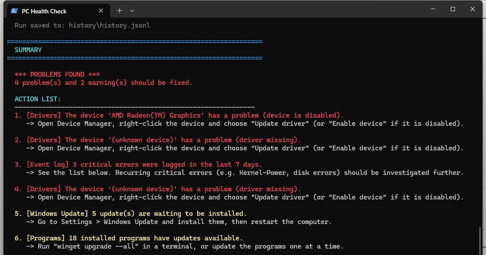

# PC Health Check 🩺💻

A free, open-source, terminal-based health check and troubleshooting tool for Windows.
Double-click one file and get a complete, color-coded overview of your computer's
components, plus a clear action list of anything that needs attention.

**No installation. No account. No data collection. Everything runs 100 % locally on your machine.**


---

## What it checks

| Section | What you get | Needs admin? |
|---|---|---|
| 🖥️ System overview | Motherboard, CPU, RAM (incl. used slots), GPU + driver age, BIOS, Windows build, uptime | No |
| 💾 Storage | Free space per drive, SMART health, plus power-on hours, wear % and disk temperature | SMART details: **Yes** |
| 🌡️ Temperatures | GPU temperature, fan speed, load and wattage (via `nvidia-smi` on Nvidia cards); CPU temperature when the firmware exposes it | No |
| ⚡ Performance | Current CPU load and the 5 most memory-hungry processes | No |
| 🔄 Windows Update | Pending Windows updates | No |
| 📦 Program updates | Installed programs with newer versions available (via `winget`) | No |
| 🛡️ Security | Defender real-time protection, signature age, last scan, firewall status | No |
| 🔌 Devices & drivers | Devices with driver problems, with plain-language error explanations | No |
| 📋 Event log | Critical errors from the last 7 days + the most common sources | No |
| 🌐 Network | MAC addresses, IP, gateway, DNS servers, DHCP, internet and DNS tests | No |
| 🔋 Battery | Charge level and battery health vs. original capacity (laptops) | No |
| 🚀 Startup programs | What starts with Windows and may slow down boot | No |
| 🧹 Cleanup | Counts temp files, Windows Update cache, dumps and recycle bin — cleans only after you answer **Y** | Full cleanup: **Yes** |
| 📈 History | Saves every run locally and shows what changed since last time | No |

Every run ends with a **summary and a numbered action list**: what is wrong
and exactly how to fix it.

## Quick start

1. Download the repository (**Code → Download ZIP**) and extract it, or clone it:
   ```powershell
   git clone https://github.com/adamsalehh/pc-health-check.git
   ```
2. Double-click **`Run-PC-HealthCheck.cmd`**
3. Read the report in the window. Done!

For the complete experience (SMART disk details, Windows temp folder cleanup),
double-click **`Run-PC-HealthCheck-Admin.cmd`** instead and accept the UAC prompt.

> 💡 **"Windows protected your PC" (SmartScreen)?** The files are unsigned plain text,
> so Windows may warn. Click *More info → Run anyway*. You can read every line of the
> code yourself first — that is the point of open source.

### Optional parameters

```powershell
# Skip the cleanup section entirely
.\PC-HealthCheck.ps1 -SkipCleanup
```

## Example output



```
==================================================================
  STORAGE (free space + disk health)
==================================================================
  [ OK ]      Drive C:: 1289,3 GB free of 1861,8 GB (69 %)
  [ OK ]      KINGSTON SNV3S2000G (SSD, 1 863 GB) - SMART: Healthy
              power-on 1 204 hours (0,1 years)  |  wear 3 %  |  temp 42 C

==================================================================
  SUMMARY
==================================================================

  *** A FEW WARNINGS ***
  The computer is fine overall, but there are 2 things worth looking at.

  ACTION LIST:
  --------------------------------------------------------------
  1. [Windows Update] 5 update(s) are waiting to be installed.
     -> Go to Settings > Windows Update and install them, then restart the computer.
```

A full, real example run is available in [docs/sample-output.txt](docs/sample-output.txt).

---

## 🔒 Security & privacy — read this before running

Running scripts from the internet deserves healthy skepticism. Here is exactly
what this tool does and does not do:

### Your data never leaves your computer

- **No telemetry, no analytics, no tracking, no ads.**
- **Nothing is uploaded anywhere.** The report is only shown in your own window.
- The optional history log is stored in plain text in the `history/` folder
  **inside the project folder on your own disk**. It is listed in `.gitignore`
  so it can never be committed or pushed by accident. Delete it anytime.

### Read-only by default

The tool only *reads* system information. The **only** thing that can ever
modify anything is the cleanup section, which:

- asks for your explicit confirmation (`Y`) before deleting anything,
- only empties well-known temp/cache folders and the recycle bin — the same
  things Windows' own Disk Cleanup removes,
- skips files that are in use,
- never touches documents, pictures, programs or settings.

### Network access — the complete list

The tool contacts the network in exactly four ways, and nothing else:

1. `ping 8.8.8.8` — a single packet to check that the internet works.
2. One DNS lookup of `www.microsoft.com` — to verify DNS resolution.
3. A Windows Update query — the standard Windows Update service on your PC.
4. `winget upgrade` — checks program versions against Microsoft's winget catalog.

There is no third-party server, no hidden endpoint, no phone-home.

### What "Run as administrator" changes

The admin launcher only unlocks two things that Windows itself restricts to
administrators: SMART disk details (power-on hours, wear) and cleaning
system-owned temp folders. All checks work without admin rights — the tool
simply tells you what it skipped.

### Open and inspectable

- The entire tool is **one readable PowerShell file** — no compiled binaries,
  no downloads, no installers.
- Before running, open `PC-HealthCheck.ps1` in any text editor and read it.
  Every command is commented.
- The `.cmd` launchers use `-ExecutionPolicy Bypass` **only for that single
  process** — your system-wide PowerShell security settings are not changed.
- Verify the files any way you like: VirusTotal, Windows Defender scan, or
  simply reading the code.

### Responsible use

This tool reports findings and suggests actions, but it cannot guarantee that a
suggested fix is right for your specific machine. Deleting files and changing
settings always carries some risk — if you are unsure about an action, look it
up first or ask someone you trust. Use at your own risk (see the MIT license).

---

## Requirements

- Windows 10 or Windows 11
- PowerShell 5.1 or newer (included in Windows)
- Optional: `winget` (included in Windows 11 and up-to-date Windows 10) for program updates
- Optional: Nvidia GPU for GPU temperature readings

## FAQ

**Why does it say temperatures cannot be read?**
Most desktop motherboards do not expose CPU temperature to Windows. Nvidia GPU
temperature works via the Nvidia driver. For full sensor readings, pair the tool
with [HWiNFO](https://www.hwinfo.com/) or NZXT CAM.

**Does it work on a laptop?**
Yes — a battery section with wear level appears automatically on laptops.

**Can I schedule it to run automatically?**
Yes. Create a task in Windows Task Scheduler that runs `Run-PC-HealthCheck.cmd`
weekly. The history feature will then show trends over time.

**Something looks wrong in the report — what do I do?**
Open an issue and include the section of the output that looks wrong
(remove your MAC/IP addresses first if you prefer to keep them private).

## Contributing

Issues and pull requests are welcome! Ideas for improvements: AMD GPU
temperatures via ADL, SFC/DISM integration, boot-time measurement, export to
HTML/PDF.

## License

[MIT](LICENSE) — free to use, modify and share, also commercially.
